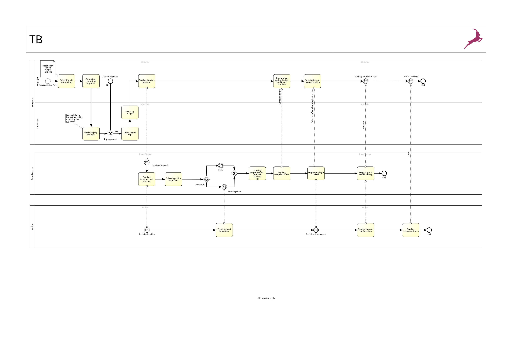
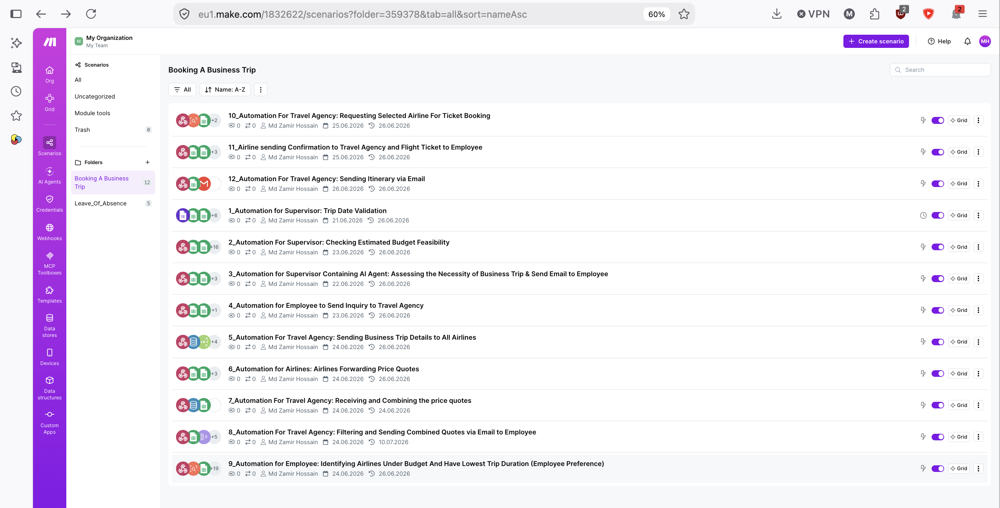
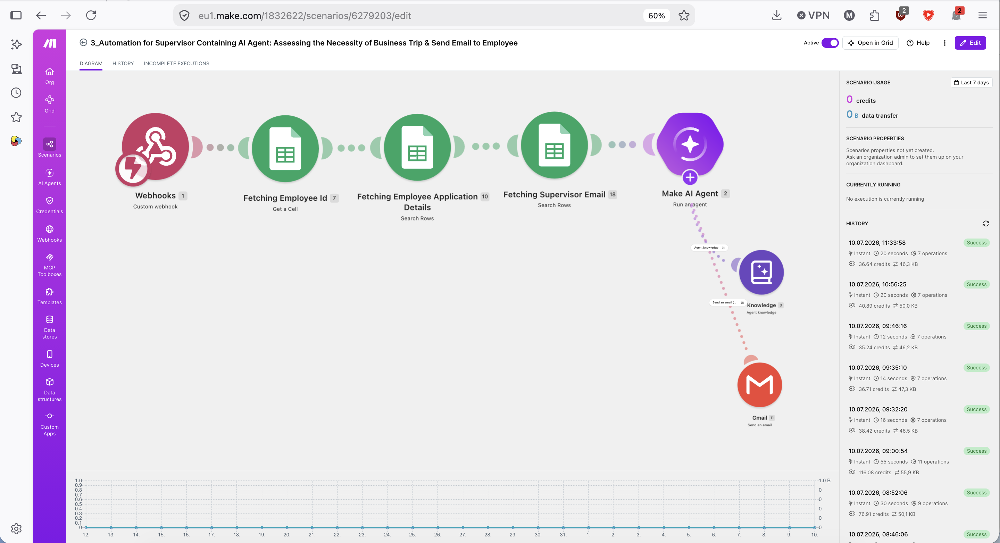
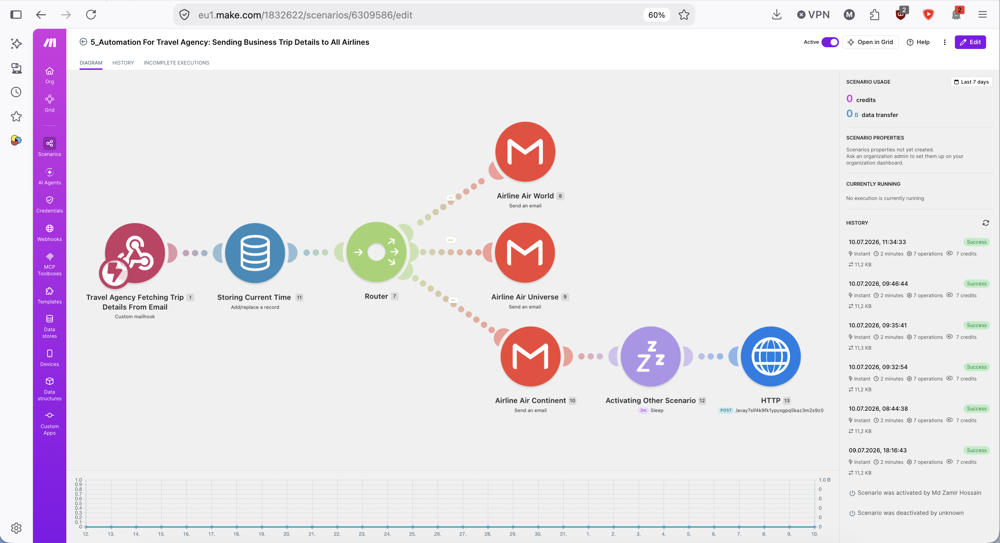
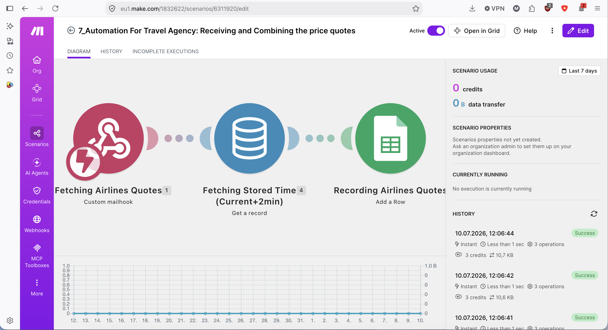
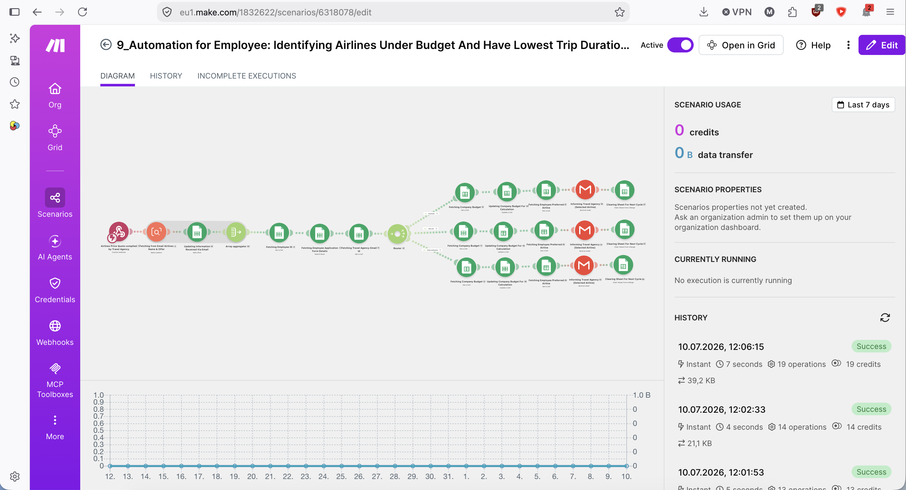
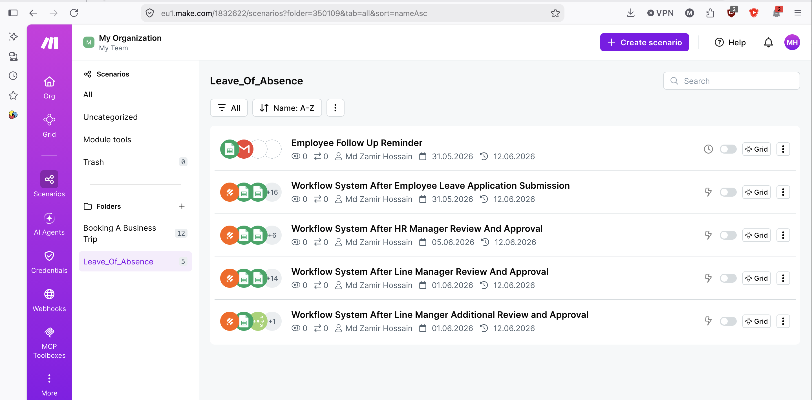
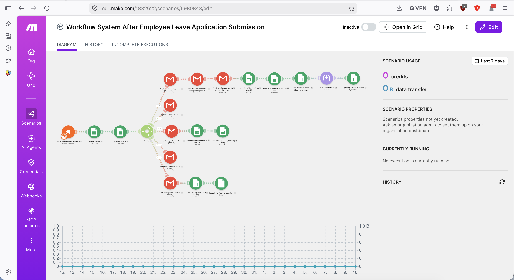
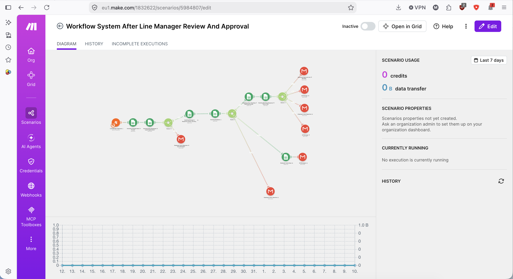

# Business Process Automation Portfolio

Two business processes modelled in **BPMN 2.0** and implemented as
working automations in **Make.com**.

---

## 1. Business Trip Request & Booking

A 12-scenario automation covering the complete travel request cycle
across four actors — Employee, Supervisor, Travel Agency and Airlines.

### Process model (BPMN 2.0)

📄 [Download the full BPMN 2.0 diagram (PDF)](bpmn-business-trip.pdf)

### Implementation

| # | Scenario | Function |
|---|---|---|
| 1 | Trip Date Validation | Validates requested dates against policy |
| 2 | Budget Feasibility Check | Compares estimate to available budget |
| 3 | AI Necessity Assessment | AI Agent evaluates whether the trip is justified |
| 4 | Employee Inquiry | Sends the request to the travel agency |
| 5 | Distribute to Airlines | Fans the request out to all carriers |
| 6 | Airline Quote Response | Carriers return price quotes |
| 7 | Receive & Combine Quotes | Aggregates responses into one dataset |
| 8 | Filter & Send Quotes | Delivers the comparison to the employee |
| 9 | Select Best Option | Identifies airlines under budget with shortest duration |
| 10 | Booking Request | Requests the ticket from the chosen airline |
| 11 | Confirmation & Ticket | Airline returns confirmation and ticket |
| 12 | Itinerary Delivery | Sends the final itinerary to the employee |

**Techniques used:** Custom Mailhook for inbound email capture with
deadline filtering · Text Parser regex to extract carrier names and
fare values from free-text replies · Text Aggregator to consolidate
competing quotes · Data Store for cross-scenario state · HTTP module
to chain scenarios · ARRAYFORMULA-based Google Sheets calculation
layer for budget comparison.

### Selected scenarios

**AI Agent — assessing trip necessity**

**Distributing the request to all airlines**

**Receiving and combining price quotes**

**Identifying the best airline by budget and duration**

---

## 2. HR Leave Management

A five-scenario automation handling leave requests through a
multi-level approval chain, from submission to calendar entry.

| Scenario | Function |
|---|---|
| Application Submission | Webhook captures the Jotform submission and opens the request |
| Line Manager Approval | Routes to the line manager and records the decision |
| Line Manager Additional Review | Handles escalated or extended requests |
| HR Manager Approval | Final approval stage |
| Follow-Up Reminder | Scheduled chase for pending approvals |

**Techniques used:** Router-based branching by leave type · webhook
and scheduled triggers in parallel · Jotform date fields arriving as
JSON collection objects, resolved via sub-field pill mapping · Google
Sheets used as a calculation engine for date arithmetic, working
around Make's Set Variable limitation on typed expressions.

### Selected scenarios

**Leave application submission**

**Line manager review and approval**

---

## Tools

Make.com (iPaaS) · BPMN 2.0 · Jotform · Google Sheets · Gmail ·
Google Calendar · Webhooks & HTTP modules · Regex

## Context

Built during an M.Sc. in AI-Driven Supply Chain Management at Hof
University of Applied Sciences, combining business process modelling
with hands-on automation implementation.
